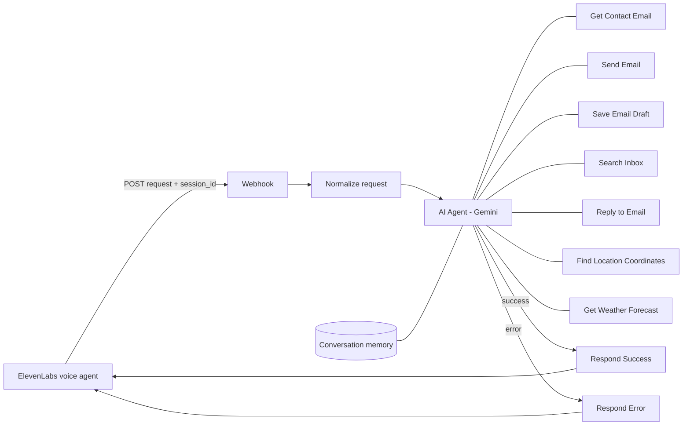

# AI Voice Assistant (Lean) - ElevenLabs + n8n

A voice-controlled personal assistant built with **n8n** and **ElevenLabs**. Speak a command to an ElevenLabs voice agent, and an n8n AI agent (Google Gemini) carries it out: it finds contacts, sends or drafts emails, reads and replies to your inbox, and gives live weather, then speaks the result back.

> Example: *"Email Ali that tomorrow's class is moved to 5 PM."* The agent looks up Ali in Google Contacts, writes a clean, signed email, sends it through Gmail and confirms by voice.

## What it can do

| Voice command | What happens |
|---|---|
| "Email Sara that the meeting is at 5 PM" | Finds Sara in Google Contacts, writes a polished email, sends it via Gmail |
| "Draft an email to Ali, don't send it" | Saves the email as a Gmail draft |
| "Any unread emails from today?" | Searches Gmail and summarises up to 5 emails in one sentence each |
| "Reply to Ahmed's last email and say yes" | Finds the email, then replies inside the same thread |
| "What's the weather in Rawalpindi?" | Looks up coordinates, then gets live weather from Open-Meteo |

## Architecture



## Nodes

| Node | Purpose |
|---|---|
| ElevenLabs Voice Webhook | Receives the POST request from ElevenLabs and waits for the final answer |
| Normalize Voice Request | Builds one clean `request` and `sessionId`; also accepts an older `to` + `emailContent` format |
| AI Voice Assistant | n8n AI Agent that decides which tools to call and writes the spoken reply |
| Gemini Chat Model | Language model (Google Gemini, temperature 0.3) |
| Conversation Memory | Keeps the last 8 exchanges per call, so follow-ups work |
| Get Contact Email | Google Contacts lookup by name |
| Send Email / Save Email Draft / Reply to Email | Gmail tools |
| Search Inbox | Gmail search with standard Gmail query syntax |
| Find Location Coordinates / Get Weather Forecast | Open-Meteo geocoding and forecast (free, no API key) |
| Respond Success / Respond Error | Returns `{ "status", "message" }` JSON that ElevenLabs reads aloud |

## Requirements

- n8n (cloud or self-hosted) with a **published** workflow, since ElevenLabs needs the production URL
- ElevenLabs account with an Agent
- Credentials in n8n:
  - Google Gemini (PaLM) API key
  - Gmail OAuth2
  - Google Contacts OAuth2
- Open-Meteo needs no key

## Setup

1. **Import the workflow.** In n8n go to *Workflows -> Import from file* and choose `workflow.json`.
2. **Connect credentials.** Open each Gmail, Google Contacts and Gemini node and select your own credentials.
3. **Personalise the prompt.** In the *AI Voice Assistant* node, edit the system message: your name, sign-off, default city and organisation.
4. **Publish** the workflow and copy the *Production URL* from the Webhook node.
5. **Create the ElevenLabs agent.** Use the prompt in [`elevenlabs-agent-prompt.md`](elevenlabs-agent-prompt.md).
6. **Add a webhook tool** in ElevenLabs:
   - Method: `POST`, URL: your n8n production URL
   - Response timeout: 30 seconds or more
   - Body parameters:

   | Identifier | Type | Value type | Value |
   |---|---|---|---|
   | `request` | String | LLM prompt | The complete spoken request in plain English |
   | `session_id` | String | Dynamic variable | `system__conversation_id` |

7. **Test.** Use *Test agent* in ElevenLabs, or call the webhook directly:

   ```bash
   curl -X POST "https://YOUR-N8N-DOMAIN/webhook/ai-voice-assistant-lean" \
     -H "Content-Type: application/json" \
     -d '{"request":"What is the weather today in Rawalpindi?","session_id":"test-1"}'
   ```

   Expected response:

   ```json
   { "status": "success", "message": "It is about 31 degrees and clear..." }
   ```

## Request and response format

Request body sent by ElevenLabs:

```json
{ "request": "Send an email to Ali saying the class is at 5 PM", "session_id": "conv_abc123" }
```

Response returned to ElevenLabs:

```json
{ "status": "success", "message": "Email sent to Ali with the subject Class Time Update." }
```

## Design choices

- **One tool, many abilities.** The voice agent has a single webhook tool. All intelligence and permissions live in n8n, so adding a capability never means changing the voice agent.
- **Safe email behaviour.** The agent never invents an address, asks nothing it can look up, sends at most one email per request, and drafts instead of sending when asked.
- **Spoken-friendly answers.** Short plain sentences, no markdown, no links.
- **Graceful failure.** An error branch returns a spoken message, so the call never hangs.
- **Per-call memory.** The ElevenLabs conversation ID keys the memory.

## Security notes

- The webhook is **unauthenticated by default**. Anyone with the URL could trigger your Gmail. Before going live, enable **Header Auth** on the Webhook node and add the same header in the ElevenLabs tool.
- Never commit credentials. This export contains credential names only, no keys or tokens.
- Review your system prompt before sharing: it may contain personal details.

## Limitations

- Open-Meteo may not recognise very small places; the agent falls back to a nearby larger town.
- No logging in this version. See the full version for an audit log and extra tools.
- Expect a few seconds of delay on multi-step requests (lookup, write, send).

## Ideas for next steps

- Google Calendar tools ("What's on my schedule tomorrow?")
- Header authentication on the webhook
- A data table or Google Sheet for command logging
- Web research and LinkedIn publishing tools

## Tech stack

n8n - ElevenLabs Agents - Google Gemini - Gmail API - Google Contacts API - Open-Meteo

## Author

**Muhammad Nadeem** - n8n AI automation specialist and Python developer
GitHub: [Kashan474](https://github.com/Kashan474) - LinkedIn: add your profile link here

## License

MIT (or choose your own)
