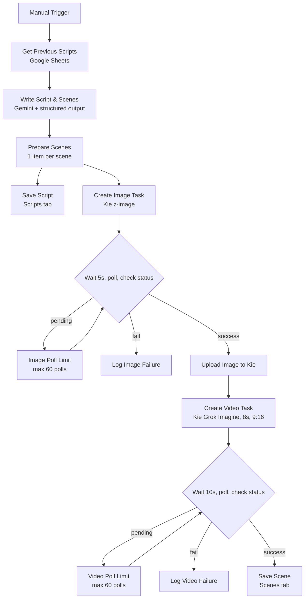

# Content Automation: AI Short-Form Video Pipeline (n8n)

An [n8n](https://n8n.io) workflow that writes a ~30-second vertical video script, splits it into 4 scenes, generates an opening-frame image for each scene, turns each image into an 8-second video clip, and logs everything to Google Sheets.

> **Name note:** the workflow and sheet are named "Veo3" for historical reasons. The current version generates video with **Grok Imagine** through [Kie.ai](https://kie.ai), not Veo 3.

## How it works

1. **Get Previous Scripts** reads the last 10 scripts so the model avoids repeating topics and hooks.
2. **Write Script & Scenes** asks Gemini for a title, hook, 60–75 word script, caption and exactly 4 scenes (`beat`, `image_prompt`, `video_prompt`). Output is forced into a JSON schema.
3. **Prepare Scenes** fans out one item per scene with a unique `key` (`<runId>-<scene>`).
4. **Save Script** stores the script immediately (so a later media failure still prevents topic repeats).
5. Each scene goes through **image → upload → video**, polling Kie.ai until the task succeeds or fails.
6. **Save Scene** writes the prompts, hosted image URL and video URL to the Scenes tab. Failed scenes are written as `FAILED (image|video): <reason> [taskId]` in the *Video URL* column and do **not** stop the other scenes.

## Requirements

| Requirement | Notes |
|---|---|
| n8n | A recent version with the AI Agent node v3.x and Google Sheets node v4.7 |
| Google account | Google Sheets OAuth2 credential |
| Google Gemini API key | `Google Gemini(PaLM) Api` credential. The model is set to `models/gemini-3.8-flash`; change it if your account offers a different one |
| Kie.ai account and API key | Used for image generation, file upload and video generation |

## Setup

### 1. Create the Google Sheet

Create one spreadsheet with **two tabs** and these exact header rows in row 1:

**Scripts**

| Run ID | Title | Hook | Script | Caption | Scenes | Timestamp |
|---|---|---|---|---|---|---|

**Scenes**

| Key | Run ID | Scene | Image Prompt | Video Prompt | Hosted Image URL | Video URL |
|---|---|---|---|---|---|---|

### 2. Import the workflow

In n8n: **Workflows → Import from File** → select `content-automation-workflow.json`.

### 3. Create credentials

- **Google Sheets OAuth2**: assign it to *Get Previous Scripts*, *Save Script*, *Save Scene*, *Log Image Failure* and *Log Video Failure*.
- **Google Gemini(PaLM) API**: assign it to *Gemini Model*.
- **Header Auth** for Kie.ai: name `Authorization`, value `Bearer YOUR_KIE_API_KEY`. Assign it to *Create Image Task*, *Get Image Result*, *Upload Image to Kie*, *Create Video Task* and *Get Video Result*.

### 4. Replace the placeholders

The exported JSON contains placeholders instead of private IDs:

| Placeholder | Where | Replace with |
|---|---|---|
| `YOUR_GOOGLE_SHEET_ID` | Document field of the 5 Google Sheets nodes | The ID from your sheet URL (`.../spreadsheets/d/<ID>/edit`) |
| `0` | Sheet field of *Get Previous Scripts* and *Save Script* | The `gid` of your Scripts tab (`#gid=...` in the URL) |
| `YOUR_SCENES_TAB_GID` | Sheet field of *Save Scene*, *Log Image Failure*, *Log Video Failure* | The `gid` of your Scenes tab |

Easiest route: open each Google Sheets node and re-select the document and tab from the dropdowns.

### 5. Run it

Make sure no node has **pinned data** (pin icon), then click **Execute workflow**.

## Configuration

| What | Where | Default |
|---|---|---|
| Niche, tone, script length, scene rules | `Write Script & Scenes` → System Message | AI and automation tips for freelancers and small business owners |
| Number of previous scripts used for de-duplication | `Write Script & Scenes` → prompt (`.slice(-10)`) | 10 |
| Image model and size | `Create Image Task` | `z-image`, 9:16 |
| Video model, resolution, duration | `Create Video Task` | `grok-imagine-video-1-5-preview`, 480p, 8 s |
| Poll interval | `Wait for Image` / `Wait for Video` | 5 s / 10 s |
| Poll cap | `Image Poll Limit` / `Video Poll Limit` (`MAX_POLLS`) | 60 (about 5 / 10 minutes) |
| Retries | Node settings on the agent and the HTTP nodes | 3 tries, 3 s apart |

The workflow is **manual-trigger only** and ships inactive. Swap in a Schedule Trigger if you want it to run on its own.

## Cost

Observed in test runs (Kie.ai credits): about **0.8 credits per image** and **19.2 credits per 8 s 480p video clip**, so roughly **77 credits per run** (4 scenes). Check current Kie.ai pricing before scheduling this.

## Error handling

- Script generation retries up to 3 times (the structured-output step occasionally rejects a malformed model response).
- Kie.ai task creation, status and upload calls retry up to 3 times.
- Status checks treat unexpected or missing responses as "pending", bounded by the poll cap.
- A task that never finishes raises an error naming the stuck task IDs.
- A task that Kie.ai reports as failed is logged to the Scenes sheet and the other scenes continue.

## Known limitations

- **Output is 4 separate clips.** Nothing stitches them together, adds a unified voice-over or publishes them.
- **Character consistency is prompt-based.** Each image is a separate text-to-image call, so the same person may look different across scenes.
- **Voices vary between clips** because each clip generates its own audio.
- **Kie.ai URLs are temporary.** Download the videos to permanent storage (Drive, S3, etc.) soon after generation.
- **Item pairing in the polling loops** relies on n8n's paired-item tracking (`$('Prepare Scenes').item`). Verify with a real run that each row in the Scenes tab has the correct prompts and URLs.
- Failures appear as `FAILED…` rows rather than failed executions, so check the sheet (or add an alert node) if you run this unattended.

## Troubleshooting

| Symptom | Likely cause / fix |
|---|---|
| "Model output doesn't fit required format" | Transient model output issue; the agent retries automatically. If persistent, try another Gemini model |
| Instant "success" and URLs that don't match the new script | Pinned data on a node. Unpin all nodes and re-run |
| `Cannot read properties of undefined` in a Sheets node | The Scenes/Scripts header row doesn't match the column names above |
| Run ends with "timed out after 60 polls" | Kie.ai task stuck; check the task ID in the Kie.ai dashboard or raise `MAX_POLLS` |
| 401 from Kie.ai | Header Auth credential must be `Authorization: Bearer <key>` |

## Changelog

**Review fixes**
- *Hosted Image URL* now stores the uploaded image URL instead of the temporary generation URL.
- Retries on the script agent and on `Create Image Task` / `Create Video Task`.
- Slower polling (5 s / 10 s) with a 60-poll cap.
- Status Switch nodes tolerate malformed responses.
- Failed scenes are logged to the sheet instead of stopping the whole run.
- Upload path renamed to `content-automation/images`.

## Files

- `content-automation-workflow.json`: the importable n8n workflow (credentials and sheet IDs removed)
- `README.md`: this file
