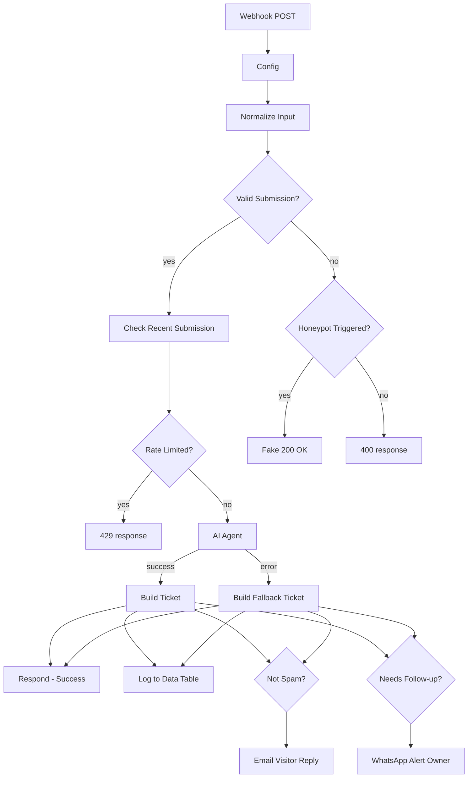

# AI Lead Capture & Smart Reply Agent

An **n8n** workflow that turns a website contact form into an automated lead pipeline. A visitor submits a question; the workflow validates it, blocks bots and spam, lets a **Gemini AI agent** answer it (with live web search), **scores the lead 0–100**, logs it to a database, **emails the visitor a branded reply** and **alerts the owner on WhatsApp** when a lead needs a personal follow-up. If the AI step ever fails, a safe fallback still captures the lead and notifies the owner.


## Features

- **Webhook API** that returns a JSON answer instantly, so any front end (Lovable, React, plain HTML) can use it
- **Input normalisation and validation**: trimmed and capped fields, email regex, question length 10–1000, allowed category list
- **Bot protection**: hidden honeypot field (bots get a fake "success"), optional shared-token header check
- **Rate limiting**: one submission per email every 120 seconds, checked against the log table
- **Gemini AI agent** with Tavily web search, Wikipedia, Calculator and per-visitor chat memory
- **Structured output**: answer, intent, lead score, sentiment, follow-up flag and next step, enforced by a JSON schema with auto-fix
- **Lead scoring and priority**: high (75+), medium (45–74), low (below 45)
- **Prompt-injection guard** in the system prompt, plus HTML-escaping of all user text placed in emails
- **Data Table log** of every lead (a lightweight CRM)
- **Branded HTML email** reply to the visitor via Gmail (skipped for spam)
- **WhatsApp owner alerts** for high-value or AI-flagged leads
- **AI-failure fallback**: the lead is still logged, the visitor gets a polite reply and the owner gets a "manual reply needed" alert

## Architecture



The AI Agent is wired to: Google Gemini Chat Model, Visitor Memory, Tavily Web Search, Wikipedia, Calculator and a Structured Output Parser (with a second Gemini model for auto-fix).

## Node reference

| Stage | Node | Purpose |
|---|---|---|
| Entry | **Webhook** | Receives the POST request and waits for a Respond node |
| Setup | **Config** | One place for owner name, bio, brand name, WhatsApp number and optional form token |
| Setup | **Normalize Input** | Cleans fields, builds `ticketId`, `sessionId`, `ip`, `tokenOk` |
| Gate | **Valid Submission?** | Length, email, honeypot and token checks |
| Gate | **Check Recent Submission** | Fetches the latest log row for this email |
| Gate | **Rate Limited?** | Blocks repeat submissions inside 120 s |
| Gate | **Honeypot Triggered?** | Separates bots from genuine input mistakes |
| Gate | **Respond – Rate Limited / Honeypot / Invalid Input** | HTTP 429 / fake 200 / 400 replies |
| AI | **AI Agent** | Answers, classifies intent, scores the lead, flags follow-up (max 4 tool iterations) |
| AI | **Google Gemini Chat Model**, **Gemini Auto-fix Model** | The LLMs |
| AI | **Visitor Memory** | Conversation context per session |
| AI | **Tavily Web Search**, **Wikipedia**, **Calculator** | Agent tools |
| AI | **Answer Parser** | Forces the JSON output schema |
| Ticket | **Build Ticket** / **Build Fallback Ticket** | Merge form data and AI output; derive priority and `needsHuman` |
| Output | **Respond – Success** | JSON answer back to the website |
| Output | **Log to Data Table** | Saves the lead |
| Output | **Not Spam?** → **Email Visitor Reply** | Branded Gmail reply |
| Output | **Needs Personal Follow-up?** → **WhatsApp Alert Owner** | Owner notification |

## Requirements

- n8n (Cloud or self-hosted) with **Data Tables** available
- **Google Gemini (PaLM) API** key
- **Tavily** account and API key (uses the `@tavily/n8n-nodes-tavily` community node; install it on self-hosted n8n)
- **Gmail** OAuth2 credential
- **WhatsApp Business Cloud API** credential, phone number ID and the owner's WhatsApp number

## Setup

1. **Import**: n8n → *Workflows* → *Import from File* → choose `workflow.json`.
2. **Create the Data Table** `lead_capture_log` with these columns, then select it in the **Check Recent Submission** and **Log to Data Table** nodes:

   | Column | Type |
   |---|---|
   | ticket_id, submitted_at, visitor_name, visitor_email, visitor_phone, category, question, ai_answer, priority, sentiment, source, intent, status, visitor_ip | string |
   | needs_human, ai_fallback | boolean |
   | lead_score | number |

3. **Add credentials** and select them on: Google Gemini Chat Model, Gemini Auto-fix Model, Tavily Web Search, Email Visitor Reply (Gmail), WhatsApp Alert Owner.
4. **Edit the `Config` node**: owner name, bio, brand name, `ownerPhone` (international format, no `+`) and `waPhoneNumberId`.
5. **Restrict CORS**: in the **Webhook** node, replace `allowedOrigins: *` with your website's domain.
6. **Activate** the workflow and copy the **Production URL** from the Webhook node.

## API contract

**Request**: `POST <your-n8n-production-webhook-url>`

```json
{
  "name": "Ayesha Khan",
  "email": "ayesha@example.com",
  "phone": "+92 300 1234567",
  "category": "Services",
  "question": "Can you automate our order notifications with n8n and WhatsApp?",
  "honeypot": "",
  "source": "website-form",
  "sessionId": "optional-client-session-id"
}
```

`category` must be one of `General Question`, `Pricing`, `Services`, `Support`, `Collaboration`, `Other`. `honeypot` must stay empty (render it as a hidden field). `phone`, `source` and `sessionId` are optional.

**Responses**

| Status | Meaning | Body |
|---|---|---|
| 200 | Processed | `{ success, ticketId, answer, suggestedNextStep, needsHumanFollowup, aiFallback }` |
| 200 | Honeypot filled (bot) | `{ success: true, answer: "Thanks! ..." }`, nothing is processed |
| 400 | Invalid email or question length | `{ success: false, error }` |
| 429 | Same email sent within 120 s | `{ success: false, error }` |

**Quick test**

```bash
curl -X POST "<YOUR_WEBHOOK_URL>" \
  -H "Content-Type: application/json" \
  -d '{"name":"Test User","email":"you@example.com","category":"Pricing","question":"How much does a custom n8n automation cost?","honeypot":""}'
```

## Lead scoring

| Score | Priority | Typical lead |
|---|---|---|
| 75–100 | high | Clear paying project, hiring or time-sensitive request |
| 45–74 | medium | Service, collaboration or training enquiry with real interest |
| 15–44 | low | General or casual question |
| 0–14 | low | Spam or irrelevant (no email reply, no alert) |

`needsHuman` is true when the AI flags follow-up **or** the score is 75+ (never for spam). That triggers the WhatsApp alert.

## Customisation

- **Identity and alerts**: edit only the `Config` node.
- **Tone, rules, scoring bands**: edit the AI Agent's system message.
- **Categories**: edit the allowed list in `Normalize Input` (`category`).
- **Throttle window**: change `120` in `Rate Limited?`.
- **Extra tools** (CRM, calendar, knowledge base): connect more tool nodes to the AI Agent.

## Security notes

- Never commit real credentials, phone numbers or your production webhook URL. This repo's JSON has them removed.
- The optional `formToken` check compares a header to a value in `Config`. If the front end sends it, treat it as a basic speed bump, not strong authentication.
- Rate limiting is keyed on email, so it slows casual spam but is not a full abuse-prevention system. Add an IP check or a CAPTCHA for high-traffic sites.
- All user text is HTML-escaped before it is placed in emails.

## Optional: failure alerts

For production use, create a separate workflow with an **Error Trigger** that sends you a WhatsApp or email message, publish it, and select it under *Workflow Settings → Error Workflow*. The in-workflow AI fallback covers AI failures only; this covers everything else.

## Tech stack

n8n · Google Gemini · Tavily · Wikipedia · n8n Data Tables · Gmail · WhatsApp Business Cloud API

## Author

**Muhammad Nadeem**, n8n AI automation specialist and Python instructor.
GitHub: [@Kashan474](https://github.com/Kashan474)
