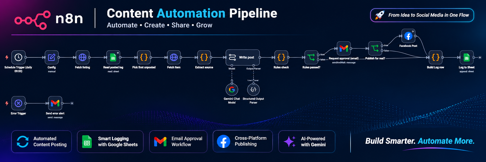

# Daily Social Post Agent (n8n)

An n8n workflow that picks one unposted news item or article from a website every day, drafts a Facebook post with Gemini, checks it against deterministic safety rules, asks a human for approval by email, then publishes (or simulates) and logs the result to Google Sheets.

> Built as a take-home technical assessment for PlacidWay's hiring process. It is not a production deployment.



*Diagram generated from `workflow.json`. Replace it with a real screenshot of your n8n canvas if you prefer (see "Screenshots" below).*

## What it does

1. **Schedule Trigger** runs daily at 09:00.
2. **Config** holds all settings in one place (`DRY_RUN`, page ID, API version, reviewer email, Gemini model, preferred content type).
3. **Fetch listing / Read posted log / Pick first unposted** scrape the listing page and choose the first item not already in the Google Sheet log (duplicate protection).
4. **Fetch item / Extract source** download the chosen page and extract title, summary, body and image.
5. **Write post** (Gemini + Structured Output Parser) drafts a hook, 2-4 value lines, a call to action and 3-5 hashtags, using only facts from the source.
6. **Rules check** (plain code, no AI) rejects a draft if it:
   - exceeds 450 characters or contains a URL
   - has the wrong number of value lines or hashtags
   - uses banned medical or outcome wording (cure, guaranteed, painless, safe, ...)
   - contains any number or price that does not appear in the source
7. **Request approval (email)** uses Gmail "send and wait" with Approve / Reject buttons and a 24-hour limit.
8. **Publish for real?** publishes only if the draft was approved **and** `DRY_RUN` is `false`.
9. **Facebook post** publishes via the Graph API; otherwise the run is simulated.
10. **Build log row / Log to Sheet** records every outcome.
11. **Error Trigger / Send error alert** emails you when any run fails.

## Design choices

- **Safe by default:** `DRY_RUN = true`, so nothing is posted until you change it.
- **AI cannot publish:** the model only drafts. A separate rule-based check and a human approval gate sit between the draft and Facebook.
- **Prompt-injection aware:** the system prompt treats scraped page content as untrusted data.
- **Fact grounding:** every number in the post must exist in the source text.
- **Auditable:** every outcome is logged with a status.

## Log statuses

`PUBLISHED`, `SIMULATED`, `REJECTED_RULES`, `REJECTED_BY_REVIEWER`, `FAILED_PUBLISH`

## Setup (about 5 minutes)

1. In n8n, choose **Import from file** and select `workflow.json`.
2. Add credentials: **Google Sheets**, **Gmail**, **Google Gemini (PaLM) API**, and **Facebook Graph API** (Facebook is not needed while `DRY_RUN = true`).
3. Create a Google Sheet with these headers in row 1:
   `date, content_type, title, url, post_text, fb_post_id, status, details`
   Paste its ID into the **Read posted log** and **Log to Sheet** nodes.
4. In the **Config** node set `REVIEWER_EMAIL`, `FB_PAGE_ID`, and `GEMINI_MODEL` (change it if that model is not available in your account).
5. In **Fetch listing**, replace the placeholder contact email in the User-Agent header.
6. In **Send error alert**, set your email, then go to Settings -> Error workflow and select this workflow.
7. Click **Execute workflow**, approve the email, and a `SIMULATED` row appears in your sheet.
8. To go live, set `DRY_RUN` to `false` in **Config** and activate the workflow.

## Requirements

- n8n (cloud or self-hosted) with LangChain nodes available
- Google account (Sheets, Gmail) and a Gemini API key
- Facebook Page ID and Graph API access token (live publishing only)

## Screenshots

For a real execution image: open the workflow in n8n, run it, click **Fit view**, and take a screenshot of the canvas. Save it as `images/execution.png`. Do not include credentials, real emails, or Page data in the image.

## Repository structure

```
.
├── README.md
├── workflow.json
└── images/
    └── workflow-diagram.png
```

## Notes

- The scraper reads public listing pages at a low rate; check the target site's terms and robots.txt before using it on other sites.
- Placeholders (`YOUR_FACEBOOK_PAGE_ID`, `YOUR_GOOGLE_SHEET_ID`, `your-email@example.com`) must be replaced before running.
